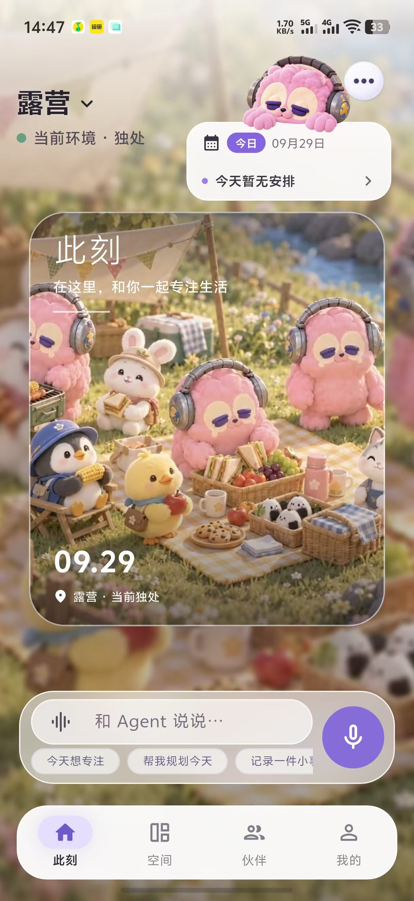
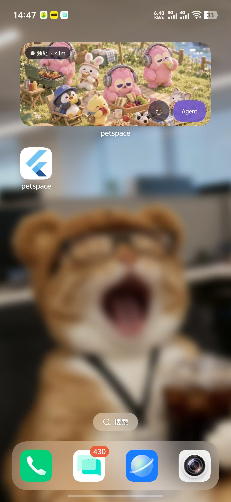
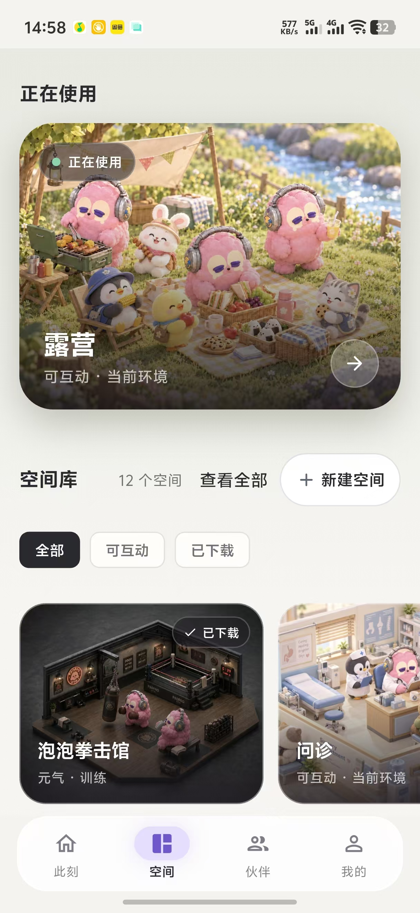
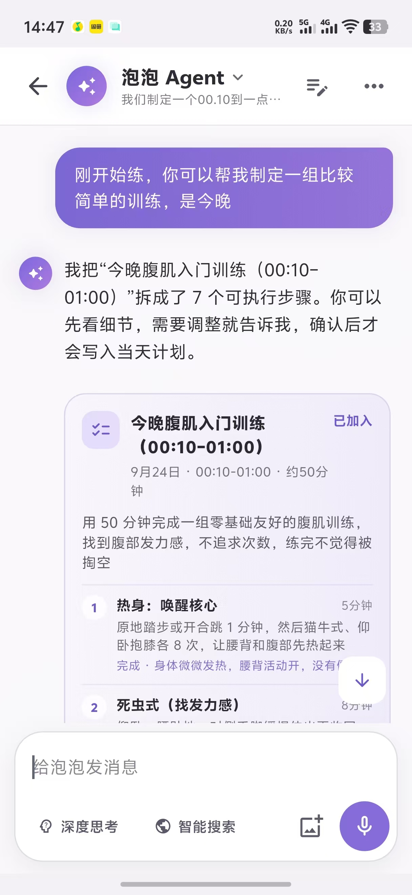
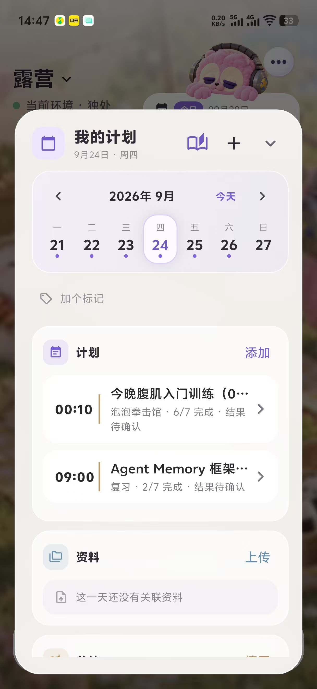
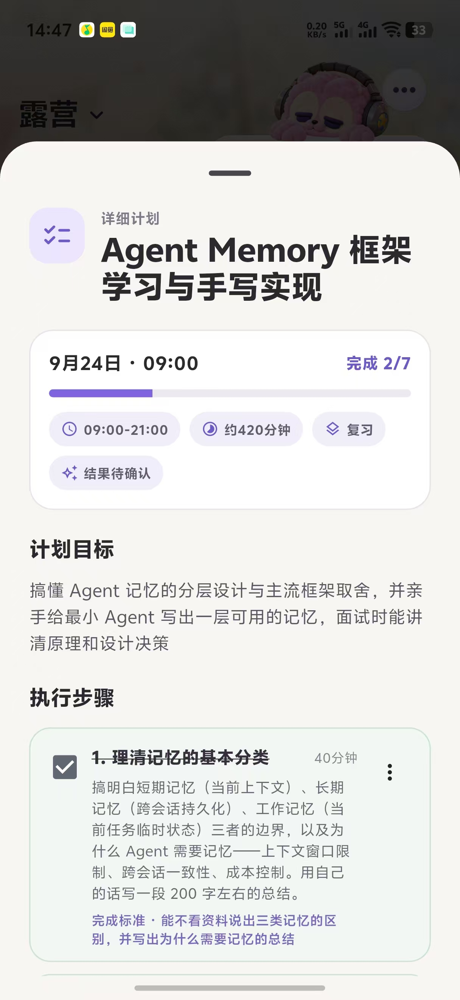

# PetSpace

> 一只住在手机与桌面上的 AI 电子宠物，也是一位真正参与计划制定与执行的生活伙伴。

<p align="center">
  
  &nbsp;&nbsp;
  
</p>

## 项目简介

PetSpace 是一款融合 **AI 电子宠物、动态空间和智能计划 Agent** 的移动应用。

电子宠物不仅出现在 App 内，也会生活在 Android 桌面 Widget 中。用户可以进入不同空间与宠物互动，通过文字或语音告诉 Agent 自己的目标，再由 Agent 将目标拆解成可确认、可执行、可复盘的计划。

项目希望形成一个完整闭环：

```text
与电子宠物对话
    ↓
Agent 理解目标并生成计划提案
    ↓
用户检查、修改并确认
    ↓
到点提醒并切换到关联空间
    ↓
逐项完成任务并记录结果
    ↓
复盘形成长期记忆，辅助下一次规划
```

## 核心体验

### 🐾 AI 电子宠物

- 宠物同时存在于 App 动态房间和 Android 桌面 Widget。
- 支持场景切换、热点点击、角色动作和状态转换。
- 可通过文字或语音随时唤起 Agent，不必先进入复杂功能页面。
- App、Widget 与计划状态保持同步，让陪伴延伸到系统桌面。

### ✨ 智能计划 Agent

- 将自然语言目标拆解为具体步骤、预计用时和完成标准。
- 计划先生成提案，用户确认后才正式写入，避免 Agent 擅自执行。
- 支持任务勾选、计划调整、时间冲突检查、到点提醒和结果确认。
- 可将计划关联到学习、运动、休息等空间，让计划不仅停留在文字中。

### 🧠 个性化记忆

- 使用“近期对话 + 会话滚动摘要 + 长期记忆”的分层上下文。
- 记录用户确认过的目标、作息偏好、执行习惯和限制条件。
- 对相互冲突的新旧记忆发起确认，而不是静默覆盖。
- 在制定计划时按需召回相关记忆，让建议逐渐贴合用户。

### 🏡 动态空间

- 通过空间库切换电子宠物所处的环境。
- 场景可包含角色状态、互动热点、动作素材和 Widget 资源。
- 支持内容版本发布与本地缓存，在网络异常时保留可用体验。

## 产品截图

### 此刻与桌面陪伴

<p align="center">
  
  &nbsp;
  
</p>

### 空间与 Agent 对话

<p align="center">
  
  &nbsp;
  
</p>

### 计划管理与执行

<p align="center">
  
  &nbsp;
  
</p>

## 技术架构

| 层级 | 技术与职责 |
| --- | --- |
| 移动端 | Flutter / Dart：房间、空间库、Agent 会话、计划与记忆界面 |
| Android 原生 | Kotlin、AppWidget、RemoteViews、AlarmManager、WorkManager |
| 服务端 | NestJS / TypeScript：内容、对话、计划、记忆与社交服务 |
| 数据层 | PostgreSQL、pgvector、结构化业务数据与语义检索 |
| AI 能力 | DeepSeek、EmbeddingGemma、流式对话与受控工具调用 |
| 内容管线 | Manifest、FFmpeg、MP4 / WebP 动作素材处理与版本发布 |

更完整的架构说明见 [docs/architecture.md](docs/architecture.md)。

## 工程亮点

- 通过 Flutter MethodChannel 同步 App 与 Android Widget 的场景、动作和计划状态。
- 使用 AlarmManager 与 WorkManager 执行后台提醒、场景切换和资源恢复，覆盖进程回收与设备重启场景。
- 使用结构化工具调用和用户确认机制约束 Agent，持久化写操作必须有明确用户意图。
- 使用轮次、时间和工具预算限制 Agent 执行链，避免重复调用与无界循环。
- 通过 pgvector 与本地 Embedding 模型完成长期记忆混合召回，并在向量服务不可用时自动降级。
- 采用 Manifest 驱动动态内容，使 App 与 Widget 可以消费同一份场景描述与版本资源。

## 项目状态

PetSpace 当前为持续迭代中的个人产品原型。本仓库仅用于展示产品设计、交互效果和技术方案，**不包含实现源码、服务端配置、模型密钥或可部署产物**。

## Source notice

This is a public showcase repository for PetSpace. The implementation remains private while the product is under active development. All screenshots and project materials are provided for portfolio viewing only.

---

© 2026 PetSpace. All rights reserved.
